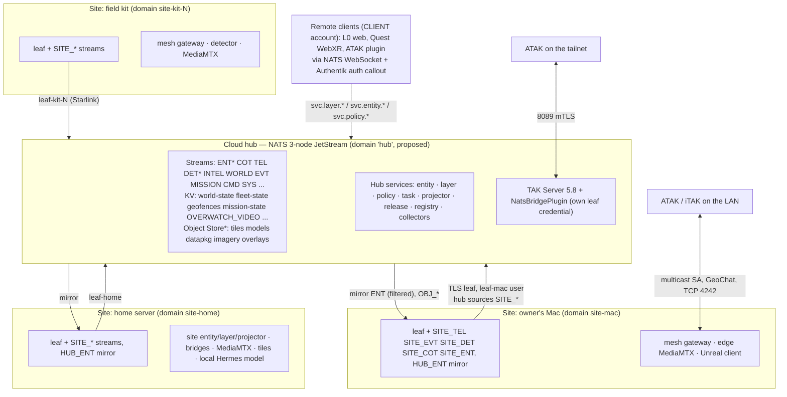
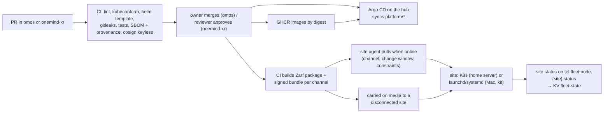

# OneMind reference architecture

Status: **M0 design, proposed.** Date: 2026-10-29. This describes the target system that
Phase 2 builds. Very little of it runs today; section 12 says exactly what is live. Every
platform change is an omos PR that the owner merges (decision 0004 #10), following omos
`CLAUDE.md` (pinned GHCR image, Argo Application, requests and limits, SealedSecrets, a
`docs/STACK.md` row).

Inputs: [`BUS-DESIGN.md`](BUS-DESIGN.md) (subjects, streams, KV, accounts; this file does not
repeat them), [`ONTOLOGY.md`](ONTOLOGY.md) (object types, actions, approval levels), the
research files in [`../research/`](../research/) (cited by name below), the decisions in
[`../decisions/`](../decisions/), [`../PREFLIGHT.md`](../PREFLIGHT.md) and
[`../sources/SOURCE-REGISTRY.md`](../sources/SOURCE-REGISTRY.md). Platform rules: omos
`CLAUDE.md` and omos `docs/NATS-DOCTRINE.md`, read at omos commit `62e3d22b` (2026-10-28).
The short overview is [`../ARCHITECTURE.md`](../ARCHITECTURE.md).

Words used here: **hub** is the cloud cluster `omos-cloud`; a **site** is any place that runs
its own NATS leaf (the owner's Mac, the home server, a field kit); a **client** is a viewer
(Unreal, web, headset, ATAK). "Proposed" means designed but not built.

---

## 1. Summary of decisions

| # | Decision | Source |
|---|---|---|
| R1 | One authority bus: the hub's 3-node NATS JetStream. Sites are leaves with their own JetStream domain; the hub **sources** site streams and sites **mirror** what they need from the hub | omos `CLAUDE.md` "Bus Authority"; BUS-DESIGN.md D1, D5; [edge-and-ddil.md](../research/edge-and-ddil.md) Rec. 1 |
| R2 | The loop is Sense → Make Sense → Act (plus Decide and Assess inside it). Observations and fused state are separate: raw on `tel.*`/`det.*`/`intel.*`/`evt.world.*`/`tak.cot.*`, fused only on `ent.{entity_type}.{entity_id}.state` | ONTOLOGY.md §1 principle 4, §8; [lattice-patterns.md](../research/lattice-patterns.md) §B |
| R3 | One owner per subject family: collectors and bridges own observations, the entity service owns `ent.*`, the task service owns task records, **only the policy service publishes `cmd.*`** (except reversible `cmd.map.>`), **only the projector publishes `tak.cot.inject`/`tak.cot.mesh.tx`** | BUS-DESIGN.md §3.3, §7.2; [security-and-trust.md](../research/security-and-trust.md) Rec. 1 |
| R4 | Every effect is an action: propose → policy (OpenFGA, fail closed) → human confirm → signed command → bridge verifies → outcome event. Agents only propose | ONTOLOGY.md §6; [agents-that-act.md](../research/agents-that-act.md) Rec. 1–2; run rule 6 |
| R5 | Ingestion standard: Go collectors on `nats.go` (`omos-ingest` in omos `services/bridge`), meeting the full reliability list. Redpanda Connect is retired after `feed-mta` migrates | [ingestion-platform.md](../research/ingestion-platform.md) Recommendation; decision 0004 #18 |
| R6 | Not everything goes on the bus: map tiles go through a caching tile proxy, video through MediaMTX, reference documents to Hermes's knowledge store, large files to the Object Store as references | SOURCE-REGISTRY.md "Routing rule"; BUS-DESIGN.md §2 |
| R7 | Clients read layers as snapshot plus delta through `svc.layer.*`, and send changes only as `svc.policy.*` requests. The client is never a source of truth | BUS-DESIGN.md D7; onemind-xr `CLAUDE.md` rule 3 |
| R8 | Deployment follows the Apollo pattern: Git `main` + Argo CD at the hub; pull-based site agents with channels and change windows at the sites; signed offline bundles for disconnected sites | [palantir-patterns.md](../research/palantir-patterns.md) "How it applies" §8; [edge-and-ddil.md](../research/edge-and-ddil.md) Rec. 4 |
| R9 | Security follows the seven zero-trust pillars; the command path is hardened first | [jadc2.md](../research/jadc2.md) Rec. 5; [security-and-trust.md](../research/security-and-trust.md) Recommendation |
| R10 | New sources, layers, actions and agent skills are plugins (one manifest, four kinds), not core changes | [video-and-plugins.md](../research/video-and-plugins.md) "Plugin model (K6)" |
| R11 | Civilian scope: no weapons, no targeting, no tracking of people; `ent.person.*` only for consenting team members; simulated assets `sim-*` only in this run | BUS-DESIGN.md D9; [jadc2.md](../research/jadc2.md) rows 16–17; decision 0004 #13 |

---

## 2. Sites and hardware tiers

| Site | Hardware (from research; nothing bought, decision 0004 #5) | Runtime | Runs | Link to hub |
|---|---|---|---|---|
| **Cloud hub** | DOKS `omos-cloud`: `onemind-hub-core-v2` 3 × 8 vCPU / 16 GiB (memory-saturated) and `onemind-ecosystem-cpu` 1 node, autoscale 1–4 | Kubernetes + Argo CD | NATS 3-node JetStream, TAK Server 5.8 + FedHub, entity, layer, policy, task, projector, release and registry services, collectors, cloud MediaMTX (`platform/onetak`), Hermes, OpenFGA, Authentik, ClickHouse, monitoring | — |
| **Home server** (later; the owner's Mac stands in today) | T3: Mac mini M4 (4 W idle, 65 W max) or similar | K3s installed air-gapped, Zarf packages | NATS leaf (domain `site-home`), site entity/layer/projector services, mesh gateway, bridges (MAVLink, ROS 2, Home Assistant, MQTT), edge MediaMTX, `pmtiles serve`/TileServer GL, local Hermes model (F9) | Tailscale to the `omos-nats` leaf load balancer (port 7422) |
| **Owner's Mac** | T3 laptop, Apple Silicon | launchd + pinned binaries from one `scripts/` setup script | NATS leaf (domain `site-mac`), mesh gateway, edge MediaMTX, the Unreal client (L2), optional Pixel Streaming host (L1) | Tailscale leaf |
| **Field kit** | T1 Raspberry Pi 5 16 GB + SSD (relay); T2 Jetson Orin Nano Super (detection, H8); Starlink Mini (25–40 W); Meshtastic or goTenna radios | systemd units or a K3s agent | NATS leaf (domain `site-kit-N`), mesh gateway, edge MediaMTX, detector, `pmtiles serve` | Starlink or cellular leaf (raised `dial_timeout`, S2 compression); TAK SA over mesh radio when no IP link |

Sources: node pools, omos `CLAUDE.md` "Cluster Access" and
[omos-live-state.md](../research/omos-live-state.md) §8; tiers and power figures,
[edge-and-ddil.md](../research/edge-and-ddil.md) §6 and Rec. 6; runtimes,
[edge-and-ddil.md](../research/edge-and-ddil.md) "Deployment". The rule that the Mac must
never be the source of truth and that the home server later becomes another leaf (and
eventually the authority) is from omos `CLAUDE.md` "Bus Authority".

Hub capacity: new workloads go to the ecosystem pool, which had about 5.3 GiB of schedulable
memory requests left on 2026-10-29; hub-core had 3.3–3.8 GiB per node
([omos-live-state.md](../research/omos-live-state.md) §8). The Phase 2 service set must fit
that or wait for an owner decision; adding a node costs money (decision 0004 #5).

---

## 3. Bus topology

### 3.1 Picture



`*` = does not exist yet (BUS-DESIGN.md §11). The same picture as text:

```
                 HUB (omos-cloud)  NATS JetStream R3 ─ ENT COT TEL DET INTEL WORLD EVT MISSION CMD ...
                   ▲ source SITE_*            │ mirror ENT (by type), OBJ_*        ▲ svc.* requests
     ┌─────────────┼──────────────┐           ▼                                   │ (CLIENT account)
 leaf-mac      leaf-home      leaf-kit-1                                  L0 web · Quest WebXR · ATAK plugin
 site-mac      site-home      site-kit-1   each: SITE_TEL/EVT/DET/COT/ENT (72 h) + HUB_ENT mirror
 Unreal L2     bridges        mesh gw ◄── LoRa/goTenna ──► ATAK in the field
 mesh gw ◄──── multicast ────► ATAK on the LAN
```

### 3.2 Rules

| Rule | Detail | Source |
|---|---|---|
| Cloud workloads connect directly | `nats://nats.nats.svc.cluster.local:4222` with a per-service credential; no sidecar | omos `CLAUDE.md` "Bus Authority" |
| Hermes is the one exception | It keeps its own `nats-leaf` sidecar; target: its own leaf credential and no JetStream | omos `CLAUDE.md`; BUS-DESIGN.md §8 |
| A leaf without a domain is not a site | Store-and-forward needs a site stream in the site's own domain; a domainless JetStream leaf extends the hub's JetStream. The committed Mac leaf has no domain and must be fixed first | [nats-platform.md](../research/nats-platform.md) §6 (P7, P7d); BUS-DESIGN.md §8; omos `infra/edge/mac-leaf/nats-server.conf` |
| No double capture | The site leaf remote sets `deny_exports` on the subjects it streams; hub aggregates are source-only for those subjects (**unverified**: not exercised) | BUS-DESIGN.md §9 item 1; P7b |
| Commands are never queued | Hub → site commands go over the leaf only while connected, recorded in hub `CMD`, with an `expires`; an offline site gets none | BUS-DESIGN.md §9 item 3; [edge-and-ddil.md](../research/edge-and-ddil.md) "What crosses a DDIL boundary" |
| One writer per key | A site's entity service owns its own assets' `ent.*` keys; the hub never writes them | BUS-DESIGN.md §9 conflict rules |
| Accounts | `SYS`, `ONEMIND` (services, sites, TAK leaf), `CLIENT` (viewers, request/reply only), `AGENTS` (stage 2), `PARTNER-<org>` | BUS-DESIGN.md §7.1 |

---

## 4. Services

"Repo" is where the code lives. "State" is what exists on 2026-10-29: **live** (running in the
cluster), **Git** (in omos `main`, not running or not verified running), **branch**,
**proposed** (Phase 2). Subjects are from BUS-DESIGN.md §3.

### 4.1 Platform services (omos)

| Service | Sites | Consumes | Produces | State | Feature |
|---|---|---|---|---|---|
| Collectors `omos-ingest` (Go, one Deployment per source group, `replicas: 1` with KV lease; push receivers 2+; bulk as CronJobs) | hub; selected at sites | upstream APIs, KV `ingest-locks`, `feed-config` | `intel.*`, `evt.world.air.{id}`, `evt.world.sea.{mmsi}`, `tel.feed.{source}.status`, dead letters `evt.sys.{source}.rejected` | proposed (replaces `feed-intel`, `feed-satellites`, Redpanda `feed-mta`, all live) | A0–A3 |
| MAVLink bridge | site | `cmd.fleet.drone.{id}.{verb}` (verifies Ed25519 signature, nonce, `expires`) | `tel.fleet.drone.{id}.position\|status`, `evt.drone.{id}.{accepted\|rejected\|completed\|failed}` | Git (`services/bridge/bridges/mavlink`, off-grammar `omos.air.*` today) | H1–H2 |
| ROS 2 bridge (zenoh-bridge-ros2dds + adapter; rosbridge fallback) | site | `cmd.fleet.robot.{id}.{verb}` | `tel.fleet.robot.{id}.*`, `evt.robot.{id}.*` | proposed | H3 |
| Home Assistant, MQTT, webhook bridges | site | — | `tel.{class}.{node}.{metric}` (ENV classes; owner proposal BUS-P1, used until ruled; locked grammar order is `tel.{node}.{class}.{metric}`) | Git (`services/bridge/bridges/`) | A8 |
| TAK mesh gateway | site only (multicast does not reach DOKS pods) | `tak.cot.mesh.tx` | `tak.cot.mesh.rx`, `tel.fleet.edge.{id}.status` | branch `feat/tak-mesh-gateway` (no PR yet) | A7, C1 |
| TAK client `tak-client` (Go, mTLS 8089, mission sync, video registration; retires cot-tap) | hub | TAK Server stream | `tak.cot.out`, `evt.mission.{name}.changed` | proposed | C3, D2 |
| NatsBridgePlugin | hub (TAK Server) | `tak.cot.inject` | `tak.cot.out` | Git; **live path broken** (section 12) | — |
| Entity service (Go, one active replica per site) | hub + each site | `COT`, `TEL`, `WORLD`, `INTEL`, `DET`, `cmd.entity.>` | `ent.{entity_type}.{entity_id}.state` (stream `ENT`), `evt.entity.{id}.{event}` (BUS-P5); serves `svc.entity.*` | proposed | A4 |
| Layer service + site monitor | hub + each site | `ENT` (ordered consumer), `tel.feed.>` | KV `world-state` (`{layer}.meta`, `{layer}.cells.z{z}`), KV `fleet-state` (`{site}`); serves `svc.layer.*` | proposed | A5 |
| Policy service (OpenFGA PEP, fail closed, signs commands) | hub; site copy for DDIL | `svc.policy.*` requests, `evt.drone.>`, `evt.robot.>`, `evt.mission.>` | `cmd.>`, `evt.so.action.{proposed\|approved\|denied\|executed\|failed}`; KV `geofences` | proposed | I4, D3 |
| Task service | hub; site copy for DDIL | `cmd.mission.{id}.{verb}` | KV `mission-state` (CAS on `status_version`), `evt.mission.{id}.{state}` | proposed | D2, H4 |
| Projector (AOI and mission-tier filter, marking check) | hub (`tak.cot.inject`), site (`tak.cot.mesh.tx`) | `ENT`, KV `geofences`, `mission-state` | `tak.cot.inject`, `tak.cot.mesh.tx`; serves `svc.cot.send` | live as `omos-tak-projector` (reads `ent.*.*.state`, sees 0 messages); AOI filter proposed | A6 |
| Geofence watcher (Tile38) | hub, site | `ENT`, KV `geofences` | `evt.map.geofence.{id}.{enter\|exit}` | proposed (Tile38 runs in `platform/onetak`) | D1 |
| Release service (cross-domain guard) | hub | `ent.*.*.state`, `evt.>`, `intel.>` | filtered exports into `PARTNER-<org>` | proposed | G-lane |
| Video registry, KLV extractor | site + hub | MediaMTX hooks/API; SRT/RTSP | entity `media[]` field ([entity.md](../contracts/entity.md)), KV `OVERWATCH_VIDEO`; `tel.fleet.drone.{id}.sensor\|footprint` (BUS-P7) | proposed | K2, K5 |
| Feed and plugin registries | hub | `sources.yaml`, plugin manifests | KV `feed-config`, plugin KV (new CR); serve `svc.registry.*`, `svc.plugins.list` | proposed | A2, K6–K7 |
| MediaMTX | edge + hub (`platform/onetak/media-mtx.yaml`) | RTSP/RTMP/SRT/WHIP/HLS in | WebRTC/WHEP, RTSP, SRT, LL-HLS out; recordings | live in hub (no auth, no registry); edge proposed | K1 |
| Hermes + onemind-core (Synadia Agent Protocol) | hub; local model at sites (F9) | `agents.prompt.hermes.>`; requests `svc.entity.*`, `svc.layer.list\|meta` | `agents.*`, `cmd.map.>` (reversible UI), `svc.policy.*.propose` | live (Hermes, onemind-mcp; onemind-core idle) | I1–I5 |
| `sink-clickhouse` | hub | `intel.>` today; `ent`, `tel`, `evt` target | ClickHouse (history, timeline) | live | B-lane timeline |

Sources: collectors and reliability, [ingestion-platform.md](../research/ingestion-platform.md)
Recommendation; bridges, [drones-robots-agents.md](../research/drones-robots-agents.md) Rec.
1, 5; TAK services, [tak-protocols.md](../research/tak-protocols.md) Rec. 1–2 and
[tak-server-and-bridges.md](../research/tak-server-and-bridges.md) Rec. 1–2; entity service,
[fusion-and-tracking.md](../research/fusion-and-tracking.md) Recommendation; policy,
[security-and-trust.md](../research/security-and-trust.md) Rec. 2; live state,
[omos-live-state.md](../research/omos-live-state.md) §3, §6, §7.

### 4.2 Client components (onemind-xr)

| Component | Role | Source |
|---|---|---|
| `OneMindBus` | `IOneMindTransport` with nats.c v3.14.0 (Mac/Win/Linux, local leaf `127.0.0.1:4222`, TLS off in process) and a WebSocket transport for Quest and remote use; callbacks into an MPSC queue drained on the game thread | [unreal-platform.md](../research/unreal-platform.md) "S5" |
| `OneMindGlobe` | Cesium for Unreal v2.30.0 on UE 5.8; open terrain and imagery; WebODM 3D Tiles; ion only with a keychain token | unreal-platform.md "S1"; decision 0004 #4 |
| `OneMindLayers`, `OneMindEntities` | snapshot + delta per layer; SoA entity store; Niagara icons far, ISM models mid, actors near; CPU grid for picking | unreal-platform.md "10,000 entities" |
| `OneMindCoT` | CoT parse and emit over NATS; CoT type → symbol table; Commo later (C4, blocked by S4) | [vrtak-porting-map.md](../research/vrtak-porting-map.md) Rec. 2; [standards.md](../research/standards.md) step 1 |
| `OneMindMission`, `OneMindHermes` | AOIs, missions, tasks, command proposals with the confirm dialog; Hermes chat and proposals | ONTOLOGY.md §6 |
| `OneMindVideo` | Electra HLS now; native RTSP/SRT/WHEP decoder spike for ≤ 1 s | [video-and-plugins.md](../research/video-and-plugins.md) Rec. 5 |
| `OneMindXR`, `OneMindStreaming` | OpenXR headset UI; Pixel Streaming 2 | unreal-platform.md "S2", "S3" |
| L0 web client | CesiumJS globe (+ flat 2D), `@nats-io/*` nats.js v3.4.0 over WebSocket, milsymbol, hls.js/WHEP | section 8 |
| `OneMindATAK` | ATAK 5.6.0 plugin, GPL-3.0; ordinary CoT plus OneMind XML detail; tasking through policy | [tak-protocols.md](../research/tak-protocols.md) "Level 4" |

---

## 5. Data flows

### 5.1 Sense

```
 public APIs ─► omos-ingest (lease, ack, dedup, schema) ─► intel.* / evt.world.air|sea.* ──► INTEL / WORLD
 drones (MAVLink) ─► MAVLink bridge ───────────────────► tel.fleet.drone.{id}.* ─┐
 robots (ROS 2) ──► zenoh → NATS adapter ──────────────► tel.fleet.robot.{id}.* ─┼─► SITE_TEL ─(source)─► TEL
 home sensors ────► HA / MQTT bridges ─────────────────► tel.{class}.{node}.* ───┘          (ENV; proposal BUS-P1, used until ruled)
 detector (Jetson) ─────────────────────────────────────► det.{domain}.{type}.{id} ─► SITE_DET ─► DET
 ATAK on LAN/radio ─► mesh gateway ─────────────────────► tak.cot.mesh.rx ─► SITE_COT ─► COT
 ATAK via server ──► TAK Server ─► tak-client / plugin ─► tak.cot.out ─────────────────► COT
 cameras/drones ───► MediaMTX ─► video registry ────────► entity media[], OVERWATCH_VIDEO
                              └► KLV extractor ──────────► tel.fleet.drone.{id}.sensor|footprint
 every collector, every 10 s ───────────────────────────► tel.feed.{source}.status (freshness)
 bad records ───────────────────────────────────────────► evt.sys.{source}.rejected (dead letter)
```

Every collector publishes with a JetStream ack and `Nats-Msg-Id`, holds one lease per source,
validates against `services/schemas`, honours rate limits and `Retry-After`, and reports
freshness ([ingestion-platform.md](../research/ingestion-platform.md) Recommendation table;
the local chaos proof is in `docs/evidence/M0/ingestion/`). Nothing publishes CoT straight to
`tak.cot.inject` any more (FEATURES A1). Map tiles never cross the bus: clients fetch them
through the caching tile proxy, or from a local PMTiles pack when offline
(SOURCE-REGISTRY.md "Routing rule"; [edge-and-ddil.md](../research/edge-and-ddil.md) Rec. 3).

### 5.2 Make Sense

```
 COT TEL WORLD INTEL DET ──durable pull──► ENTITY SERVICE ──► ENT  ent.{type}.{id}.state  (1 per subject, Nats-TTL)
   identity keys + alias map                │                 ├─► layer service ─► KV world-state  {layer}.meta, cells
   Kalman / IMM, GNN for det.*              │                 │                   serves svc.layer.snapshot|watch
   track-to-track correlation               │                 ├─► projector ─► tak.cot.inject (hub) / tak.cot.mesh.tx (site)
   per-attribute conflict rules             │                 ├─► geofence watcher ─► evt.map.geofence.{id}.enter|exit
                                            │                 ├─► sink-clickhouse (history)
                                            └─► evt.entity.{id}.created|expired|conflict|... (BUS-P5)
                                                              └─► Hermes via svc.entity.* (never the raw firehose)
```

| Step | Design | Source |
|---|---|---|
| Fusion | Deterministic key identity first, then a per-entity constant-velocity Kalman filter (IMM later), GNN with chi-square gating for keyless `det.*`, track-to-track correlation with covariance intersection; auto-merge only on shared keys | [fusion-and-tracking.md](../research/fusion-and-tracking.md) Recommendation |
| Provenance | `sources[]` with stream and sequence pointers, `aliases[]`, `expiry_time`, `live`, decomposed confidence, lifecycle `tentative/active/stale/lost/expired` | fusion-and-tracking.md; [lattice-patterns.md](../research/lattice-patterns.md) §A; `docs/contracts/entity.md` |
| Snapshot and delta | A client loads a layer snapshot (`svc.layer.snapshot`, AOI-filtered) and then applies deltas (`svc.layer.watch`), so it renders snapshots, not firehoses | [`layer-snapshot.md`](../contracts/layer-snapshot.md), [`layer-delta.md`](../contracts/layer-delta.md); onemind-xr `CLAUDE.md` |
| Mission tier to TAK | Only entities inside an AOI or geofence, or tasked, become CoT, and only if their marking allows | FEATURES A6; [security-and-trust.md](../research/security-and-trust.md) §5 |
| Watch jobs | Deterministic watchers on JetStream/KV raise events; Hermes explains and proposes only when triggered | [agents-that-act.md](../research/agents-that-act.md) Rec. 4 |

### 5.3 Act (Decide → Act → Assess)

```mermaid
sequenceDiagram
  autonumber
  participant P as Proposer (person in UI, watch job, or Hermes)
  participant POL as Policy service
  participant FGA as OpenFGA
  participant UI as Human in the OneMind UI
  participant CMD as CMD stream
  participant BR as Site bridge (MAVLink / ROS 2)
  participant AS as sim-* asset
  P->>POL: svc.policy.command.propose (action, target sim-x1, params)
  POL->>POL: schema, sim-* check, verb allowlist, geofence and time conditions
  POL->>FGA: Check can_propose / can_execute (fail closed)
  POL-->>P: evt.so.action.proposed
  POL->>UI: confirm request (level A3; A4 needs two people)
  UI->>POL: svc.policy.command.confirm (human only; agents denied)
  POL->>CMD: JetStream publish cmd.fleet.drone.sim-x1.goto (signed, nonce, expires) — PubAck = audit receipt
  POL-->>P: evt.so.action.approved / executed
  CMD-->>BR: core delivery over the leaf (only while connected; never replayed)
  BR->>BR: verify Ed25519 signature, nonce, expiry locally
  BR->>AS: MAVLink DO_REPOSITION
  BR-->>POL: evt.drone.sim-x1.accepted → completed / failed
  AS-->>BR: telemetry
  BR-->>P: tel.fleet.drone.sim-x1.position → ENT (Assess)
```

Rules, all from ONTOLOGY.md §6 and BUS-DESIGN.md §3.3:
- Approval levels A0–A5. Every asset command is at least A3 (policy, audit, one human
  confirm), even in simulation (run rule 6). `estop` needs a two-person confirm
  ([drones-robots-agents.md](../research/drones-robots-agents.md) Rec. 1).
- Agents get `can_propose`, never `can_execute`; Hermes is denied every `cmd.*` except
  `cmd.map.>` and every `svc.policy.*.confirm` ([agents-that-act.md](../research/agents-that-act.md)
  Rec. 1; BUS-DESIGN.md §7.2).
- `CMD` uses `discard: new`, so a full stream refuses the publish and the policy service
  fails closed (BUS-DESIGN.md §4.1).
- Tasks and missions follow the same path with `svc.policy.task.propose`; the task service
  keeps state in KV `mission-state` and reports on `evt.mission.{id}.{state}`
  ([`mission-task.md`](../contracts/mission-task.md)).
- Commands to TAK users (markers, routes, chat) go through `svc.cot.send` to the projector,
  never by publishing `tak.cot.inject` directly (BUS-DESIGN.md §3.4).
- The forbidden actions (target, follow or intercept a person, any weapon effect) do not
  exist in the catalogue, and the policy service rejects unknown verbs
  ([jadc2.md](../research/jadc2.md) Rec. 2; ONTOLOGY.md §1 principle 6).

The first end-to-end loop (FEATURES H4 acceptance): a `det.*` track near a zone, a watch job
proposes an `orbit` for `sim-x1`, a human confirms, the MAVLink bridge executes, and
`evt.mission.*` reaches `done_ok`, with the CoT projection checked by `takproto` decode
([lattice-patterns.md](../research/lattice-patterns.md) Rec. 5).

---

## 6. Video path (MediaMTX)

Video stays in MediaMTX and never travels on NATS. The bus carries only the stream registry
(entity `media[]` field, [entity.md](../contracts/entity.md); KV `OVERWATCH_VIDEO`) and KLV-derived telemetry
([video-and-plugins.md](../research/video-and-plugins.md) "Video path"; run prompt §11).

```
 drones (RTSP from companion; SRT over lossy links)   owned cameras (RTSP pull, sourceOnDemand)
 phones / browsers / OBS (WHIP, RTMP)                 public cameras (HLS pull where terms allow;
            │                                          MJPEG/snapshots via a snapshot proxy)
            ▼
 EDGE MediaMTX (Mac / home server / field kit)  ── forward over SRT on the tailnet ──►  CLOUD MediaMTX (platform/onetak)
   paths {class}/{entity_id}: drone/sim-x1, cam/gate-north                            JWT auth (Authentik), record
   record locally (fMP4; MPEG-TS for KLV paths)                                       remote readers: LL-HLS, HLS
   LAN readers:  WebRTC/WHEP ≤ 300 ms  ·  RTSP/SRT ≤ 1 s  ·  LL-HLS 2–5 s
            │ hooks
            ├─► video registry ─► ent.{type}.{id}.state media[], KV OVERWATCH_VIDEO
            ├─► KLV extractor  ─► tel.fleet.drone.{id}.sensor | footprint
            └─► projector ─────► CoT __video + ConnectionEntry + sensor; POST /Marti/api/video (via tak-client)
```

| Topic | Design | Source |
|---|---|---|
| Topology | The edge MediaMTX is local-first and forwards to the cloud; the cloud keeps working when the Mac is off, mirroring the bus rule | video-and-plugins.md "Video path" item 1 |
| Auth | Phase A: `internal` users per role from a SealedSecret (env override **unverified**). Phase B: `authMethod: jwt` against Authentik's JWKS | item 4 |
| Recording | drones 7 days, owned cameras 3 days, public cameras none; `do-block-storage-retain` PVC; recordings excluded from VolSync by default | item 5; omos `CLAUDE.md` deployment pattern 6 |
| Exposure | RTSP, SRT, LL-HLS, WHIP on the tailnet only (Tailscale Service, as for TAK) | video-and-plugins.md Rec. 1 |
| TAK | `__video` + `ConnectionEntry` in CoT and FeedV2 registration, so every TAK user sees the same streams; MPEG-TS URLs for KLV streams so ATAK draws its own footprint | item 8 |
| Unreal (macOS, Quest) | One `UMediaTexture` per stream on a panel tied to the entity. Situational class: Electra on HLS (macOS and Android). Tactical class (≤ 1 s): native decoder spike (VideoToolbox / MediaCodec) | items 9–10 |
| Drape on the twin | Step 1: frustum, footprint polygon and a monitor plane. Step 2: projective texturing through a decal over Cesium tiles (decals on Cesium tiles **unverified** until S1) | item 11 |
| CloudTAK | media stays off until its replacement gate is done | video-and-plugins.md Rec. 1 |

Today the cloud MediaMTX runs in `platform/onetak` without auth or a registry, and Hermes's
MediaMTX adapter is disabled with "HTTP 401" ([omos-live-state.md](../research/omos-live-state.md)
§7; [video-and-plugins.md](../research/video-and-plugins.md) fact A).

---

## 7. Plugin model

One manifest (`onemind-plugin.yaml`, schema `docs/contracts/plugin-manifest.schema.json`, to be
written), four kinds, one registry on the bus. Each host reads the same manifest and ignores
what it cannot run ([video-and-plugins.md](../research/video-and-plugins.md) "Plugin model").

| Kind | What it is | Runs in | Guard |
|---|---|---|---|
| **source** | a collector meeting the pipeline standard | omos, pinned GHCR image, Argo Application | NATS publish permissions are **generated from** `bus.publishes`, and CI validates every subject against the locked grammar |
| **layer** | declarative mapping from subjects or KV snapshots to entity type, symbology, LOD, caps | Unreal `OneMindLayers`, L0 CesiumJS, ATAK (as CoT, or in `OneMindATAK`) | code layers only at trust `built-in`/`verified` |
| **action** | a typed `cmd.{domain}.{entity}.{action}` handler with a JSON Schema; UI generated from the schema | policy service + owning bridge | always policy, audit and human confirm |
| **skill** | a Hermes plugin exposed as `svc.{service}.{endpoint}`, with declared tools for Hermes and MCP | Hermes, installed through GitOps | skills that act go through the action path |

Discovery: manifests in a plugin KV bucket (one new `KeyValue` CR through an omos PR), listed
with `svc.plugins.list`. Trust tiers: `built-in`, `verified` (signed, reviewed), `community`
(declarative only); K7 adds signature checks in the UI. Unreal does not load plugin code at
runtime: data-driven layers load at runtime, content packs mount with
`MountExplicitlyLoadedPlugin`, code ships as compiled `OneMind*` plugins. VR-TAK `VH_Plugins`
is not ported (it needs engine patches) ([vrtak-porting-map.md](../research/vrtak-porting-map.md)
Rec. 3). First examples (K6): a USGS quake source + layer, an `orbit` action on `sim-*`, a
Hermes `svc.*` skill. Design patterns come from gods-eye-view (MIT) and the worldwideview SDK
(design only, Elastic 2.0, no code).

---

## 8. Client tiers

| Level | Client | Bus access | Video | Offline | State |
|---|---|---|---|---|---|
| **L2** | Unreal 5.8 native on the owner's Mac (first target) | nats.c to the local site leaf `127.0.0.1:4222`; trusted site client, may read `ENT` directly | Electra HLS; native ≤ 1 s decoder (spike) | yes, with the site leaf, entity service, PMTiles/3D Tiles and local Hermes (F9) | source code; UE cannot be installed on the build machine (25 GiB free, PREFLIGHT.md); S1 is an owner-checklist step |
| **L1** | Pixel Streaming 2 from the Mac to any browser | none in the browser (the Mac app holds the bus) | inside the stream | no (decision 0002) | unproven on macOS: the UE 5.8 docs contradict themselves and the one recent Mac report shows a flat colour ([unreal-platform.md](../research/unreal-platform.md) facts 8–10). Fallback (0004 #1): L0 is the web path; a Linux GPU host is documented, not provisioned |
| **L0** | Light web client: CesiumJS 3D globe and flat 2D on one layer catalog, installable PWA, touch | nats.js v3.4.0 over NATS WebSocket into the `CLIENT` account, identity from Authentik through auth callout; `svc.layer.*`, `svc.entity.*`, `svc.policy.*` only | WHEP or LL-HLS (hls.js) | no; the browser is never the disconnected client (decision 0002). A PWA on the site's LAN can still reach the site leaf | proposed (J1, J6); benchmark gate G4: ≥ 57.6 fps and cold start ≤ 1.86 s |
| **L3** | Meta Quest Pro (DK94EC) standalone Android/OpenXR build | `WsNatsTransport` (NATS over WebSocket), because nats.c has no WebSocket and its Android build is unverified | Electra HLS on Android; MediaCodec decoder later | partial (needs a reachable site leaf) | spike S3; Epic OpenXR only, Meta XR plugin off (fails to load in 5.8); 72 fps reduced layer budget. Fallbacks (0004 #2): WebXR in the headset browser with L0, then Pixel Streaming's WebXR frontend |
| **L4** | ATAK / iTAK / TAKX / WinTAK, unchanged | none; they get the mission tier as CoT over TAK Server (tailnet 8089) and over the mesh | `__video` URLs, TAK video manager | yes, on the mesh | live TAK Server; mesh gateway on branch |
| **L4+** | `OneMindATAK` plugin inside ATAK | ordinary CoT plus a small OneMind API (or NATS WebSocket), tasking through policy | as L4 | as L4 | deferred (F-lane) |

Sources: [unreal-platform.md](../research/unreal-platform.md) Recommendation;
[nats-platform.md](../research/nats-platform.md) §8–9; decisions 0002, 0003, 0004 #1–#2;
[tak-protocols.md](../research/tak-protocols.md) "Level 1"–"Level 4";
[competitive-matrix.md](../research/competitive-matrix.md) Rec. 4; FEATURES F1–F4, J1, J3, J6.

All tiers use the same contracts in [`../contracts/`](../contracts/) and the same layer
manifests, so a layer added as a plugin appears everywhere without client-specific code.
Viewers never hold TAK certificates: one TAK identity per deployment (the `tak-client`)
([tak-protocols.md](../research/tak-protocols.md) Level 1 item 5).

---

## 9. Deployment and update flow (Apollo-style)

### 9.1 Pattern

| Apollo idea | OneMind equivalent | Source |
|---|---|---|
| Hub | omos Git `main` + Argo CD on `omos-cloud` (59 Applications reconcile from `main`) | omos `CLAUDE.md` "What This Repo Is"; [palantir-patterns.md](../research/palantir-patterns.md) AP4 |
| Spoke control plane | A small **site agent** per site that reports observed versions and health and **pulls** its desired state; Argo at the hub cannot reach a disconnected site | [edge-and-ddil.md](../research/edge-and-ddil.md) §1 (O5), "Deployment" |
| Release channels | Git refs or OCI digests: `canary` (hub and the owner's Mac), `stable` (home server, field kits). Promotion: CI green plus N hours on canary with no `evt.sys.*` alarms | palantir-patterns.md "How it applies" §8 |
| Constraints | Each release declares the schema and envelope versions it supports; each site declares change windows (for example "not during an active mission"); the site agent refuses a plan that breaks either | palantir-patterns.md AP2, §8 |
| Disconnected install | Signed offline bundle: OCI images by digest + Git bundle + tile packs, carried or pulled | edge-and-ddil.md "What crosses a DDIL boundary" |
| Approval and audit | omos PRs merged by the owner; onemind-xr merges after an independent review agent | decision 0004 #10; run prompt "The two repositories" |

### 9.2 Flow



| Tier | Runtime | Update path | Source |
|---|---|---|---|
| Hub | Kubernetes | Argo CD from `main`; never `helm upgrade`, `kubectl apply` or `platform/install.sh`; new workloads get an Argo Application | omos `CLAUDE.md` |
| Home server | K3s installed air-gapped (binary and image archive from the same release) | Zarf packages (Apache-2.0, single binary, own registry and Gitea mirror) built in CI from the same pinned images and charts Argo uses | [edge-and-ddil.md](../research/edge-and-ddil.md) §1 (S13, S14), Rec. 4 |
| Owner's Mac | launchd + pinned binaries (nats-server, MediaMTX, mesh gateway) from one `scripts/` setup script; the Unreal app as a packaged `.app` | pulls a signed bundle when online; the owner runs the setup script (OWNER-CHECKLIST) | edge-and-ddil.md "Deployment"; run prompt "Where this runs" |
| Field kit | systemd or K3s agent on Pi 5 / Jetson | the same Zarf package or a tarball of pinned binaries | edge-and-ddil.md "Deployment" |
| Clients | `.app`, APK (Quest, ATAK plugin), static web bundle for L0 | built in onemind-xr CI; L0 served by the hub ingress (tailscale class) and by the site | FEATURES F1, F4, J1 |

Site status: the edge lane's `tel.{node}.sys.{metric}` is remapped to
`tel.fleet.node.{site}.status` under owner proposal BUS-P1 (BUS-DESIGN.md §3.1). Upgrades are a
pull by the site agent, not a command on the bus, so no new `cmd.*` verb is needed (see
section 13). KubeEdge (supports Kubernetes only to 1.32; the hub runs 1.36) and RDFM (needs A/B
partitions) are deferred until hardware is chosen ([edge-and-ddil.md](../research/edge-and-ddil.md)
§1, Rec. 4).

Supply chain on every path: SBOM, provenance, cosign keyless signing and `attest` on every
build workflow; images pinned by digest; Kyverno ImageValidatingPolicy for
`ghcr.io/onemindos/*` in Audit first ([security-and-trust.md](../research/security-and-trust.md)
§6, Rec. 4).

---

## 10. Security zones

### 10.1 Zones

```
 ┌──────────────────────── Z0 PUBLIC INTERNET ─────────────────────────────────────────────┐
 │ upstream APIs, public cameras, tile providers  (collectors and the tile proxy reach out; │
 │ nothing reaches in except nginx ingress with the Cloudflare allowlist)                   │
 └─────────────────────────────────────────────────────────────────────────────────────────┘
 ┌──────────── Z1 TAILNET (transport only: grants nothing by itself) ──────────────────────┐
 │ ┌──── Z2 HUB CLUSTER ─────────────────────┐   ┌──── Z3 SITE (one per site) ───────────┐ │
 │ │ Z2a bus core: NATS SYS / ONEMIND        │◄──┤ site leaf, own leaf-<site> user,      │ │
 │ │ Z2b services: one NATS user each        │TLS│ verify: true; WS/MQTT on 127.0.0.1    │ │
 │ │ Z2c COMMAND PATH: policy svc, OpenFGA,  │   │ Z3c site command path: bridges verify │ │
 │ │     CMD stream (fail closed, signed)    │──►│     signature, nonce, expiry locally  │ │
 │ │ Z2d TAK: TAK Server, FedHub (8089/8443/ │   │ mesh gateway (mesh input = untrusted) │ │
 │ │     8446 tailnet only)                  │   │ edge MediaMTX, sim-* assets           │ │
 │ │ Z2e agents: Hermes (own user, svc.* only)│   └───────────────────────────────────────┘ │
 │ └─────────────────────────────────────────┘                                              │
 │ Z4 CLIENTS: CLIENT account via Authentik + auth callout; requests only, no data publish  │
 └─────────────────────────────────────────────────────────────────────────────────────────┘
 Z5 PARTNERS: PARTNER-<org> accounts fed only by the release service; TAK federation via FedHub
```

| Zone | Trust rule | Controls | Source |
|---|---|---|---|
| Z0 Public | untrusted input | schema at the bus edge, dead letters, rate limits; public ingress only through nginx with the Cloudflare allowlist | [ingestion-platform.md](../research/ingestion-platform.md); omos `CLAUDE.md` "Public ingress" |
| Z1 Tailnet | transport, not identity | Tailscale grants per tag (omos `platform/core/policy.hujson`); the `tag:k8s` → owner Mac SSH grant should be narrowed (owner decision) | [security-and-trust.md](../research/security-and-trust.md) §1, T8 |
| Z2 Hub | per-identity least privilege | one NATS user per service with publish allow-lists; NetworkPolicy; Kyverno, Falco, OpenFGA (omos `platform/security`) | security-and-trust.md §1, §3 |
| Z2c Command path | the only place a breach becomes physical | only the policy service publishes `cmd.>`; OpenFGA fail closed; Ed25519-signed commands with nonce and `expires`; `CMD` 365 d audit, `discard: new` | security-and-trust.md Rec. 2; BUS-DESIGN.md §4.1 |
| Z2e Agents | treat as possibly prompt-injected (T1) | own user limited to `agents.>` + `svc.*`; no raw `intel.>`/`tel.>` firehose; propose only; evals and an injection corpus before any write tool | [agents-that-act.md](../research/agents-that-act.md) Rec. 1, 6 |
| Z3 Site | a stolen kit or infected Mac must not reach other sites (T2) | per-site hub user with both-direction allow-lists (enforced at the hub, proved); `cmd.fleet.{class}.{id}.>` enumerated per owned asset; leaf mTLS; site keeps its own policy when cut off | security-and-trust.md §1, fact 16; BUS-DESIGN.md §7.3 |
| Z4 Clients | a lost device or token (T6) | Authentik-backed short-lived NATS identity through auth callout; no shared passwords; viewers hold no TAK certificates | security-and-trust.md §2 |
| Z5 Partners | over-sharing (T10) | TLP 2.0 marking + releasability in headers and the `ent` payload; release service is the enforcement point; outgoing CoT omits `access` unless a federation config names it; OneMind groups map 1:1 to TAK groups | security-and-trust.md §5 |

### 10.2 The seven zero-trust pillars

| Pillar (DoD ZT Strategy, [jadc2.md](../research/jadc2.md) §6) | OneMind control |
|---|---|
| User | Authentik identities and roles (J2); human-only confirm endpoints |
| Device | leaf mTLS per site; TAK client certificates with a CRL for lost EUDs (owner decision) |
| Applications and workloads | one NATS user per service, generated plugin permissions, signed images |
| Data | TLP marking + releasability on every record; release service; provenance on entities |
| Network and environment | tailnet-only admin and TAK ports; NetworkPolicy; DOKS control-plane firewall (owner decision, omos H3) |
| Automation and orchestration | policy service + OpenFGA on every action; GitOps-only deploys |
| Visibility and analytics | `evt.so.action.*` audit, `CMD` retention, Prometheus/Loki/Tempo, Falco with an alert receiver |

Threats T1–T12 and their controls are in [security-and-trust.md](../research/security-and-trust.md)
§7; this architecture places each control in the zone above.

---

## 11. Disconnected operation (DDIL)

| Cut | What keeps working | What stops | Source |
|---|---|---|---|
| Hub unreachable from a site | Site leaf, site streams (72 h), site entity/layer/projector, local policy with human confirm, mesh gateway with ATAK, local MediaMTX, PMTiles and 3D Tiles, local Hermes model, the L2 client | Hub-sourced feeds age out (shown stale); no remote commands to the site; remote L0 viewers lose that site | [edge-and-ddil.md](../research/edge-and-ddil.md) "What crosses a DDIL boundary"; FEATURES F9 |
| Reconnect | Hub sources the site streams; catch-up took 7 s, about 16 s and 41 s in three local runs; site monitor shows "site syncing" above 10 s lag | Commands issued during the outage are not replayed; a task is offered again only through a new human confirm | BUS-DESIGN.md §9; edge-and-ddil.md ER4, ER5 |
| No IP link at all | TAK SA and chat over Meshtastic or goTenna at TAK v1 sizes (one 281-byte SA event is about 2.1 s of LONG_FAST airtime, arithmetic) | Tiles, models and video never cross mesh radio | edge-and-ddil.md §5 |
| Conflicts | One writer per key; `(ts, origin, seq)` in every value; `evt.entity.{id}.conflict` (BUS-P5); CAS for human edits; GPS time where present | — | BUS-DESIGN.md §9 |

---

## 12. Current state versus target (2026-10-29)

| Area | Today (verified) | Target | Source |
|---|---|---|---|
| Entity layer | Nothing publishes `ent.*.*.state`; projector counts `ent=0`; `world-state` and `fleet-state` never written | `ENT` stream + entity service + layer service | [omos-live-state.md](../research/omos-live-state.md) §4–5 |
| Feeds | `feed-mta` (Redpanda) and `feed-satellites` publish CoT straight to `tak.cot.inject`; aircraft and ships are off since 2026-08-27; `feed-intel` publishes `intel.*` to JetStream | Go collectors, raw observations only | omos-live-state.md §3–4 |
| TAK leg | Bus → TAK broken: no subscriber behind `tak-nats-leaf`, `COT` has one subject (`tak.cot.inject`), nothing on `tak.cot.out` in 30 days; the plugin is probably not in the running plugins image | `tak-client` + a verified NatsBridgePlugin | omos-live-state.md §6 |
| Mesh | Gateway on branch `feat/tak-mesh-gateway`, no PR | merged, one per mesh interface, GeoChat and mesh crypto added | [tak-server-and-bridges.md](../research/tak-server-and-bridges.md) Rec. 1 |
| Streams | only `WORLD` has a byte cap; `COT` holds 4.95 GB unread | caps on every stream; `ENT`, `DET` | [nats-platform.md](../research/nats-platform.md) §1; BUS-DESIGN.md §11 |
| Identities | one shared account; Hermes and TAK leaves share `leaf_tak`; Mac leaf has no domain and `tls insecure` | per-service, per-site, `CLIENT` account | [security-and-trust.md](../research/security-and-trust.md) T1–T2; [edge-and-ddil.md](../research/edge-and-ddil.md) §2 |
| Video | cloud MediaMTX without auth or registry | edge + cloud, auth, recording, registry | section 6 |
| Client | no Unreal on the build machine; local nats-server, MediaMTX and a scripted MAVLink drone `sim-x1` run here | L2 on the Mac, L0 web, L3 headset | [PREFLIGHT.md](../PREFLIGHT.md) |

Build order follows from this: stream caps → `ENT`/`DET` with the entity service → collector
framework and feed migrations → identities and the policy service → layer service → projector
AOI filter → mesh gateway PR → video PR → site template (BUS-DESIGN.md §11; nats-platform.md
Rec. §6; ingestion-platform.md migration plan). Client lanes run against a local nats-server
and unmerged omos branches meanwhile (decision 0004 #11).

---

## 13. Gaps found while synthesizing (for BUS-DESIGN.md and the owner)

These are additions to the owner proposals in BUS-DESIGN.md §10 (decision 0004 #8), and all are listed
in its combined register, §10.1. No new subject pattern is invented here.

| # | Gap | Evidence | Proposal |
|---|---|---|---|
| RA1 | The video registry's `evt.video.{entity_id}.online\|offline` fits the grammar `evt.{domain}.{entity}.{event}`, but no stream binds `evt.video.>` (omos `platform/nats/streams/evt.yaml` lists `so hp le ge task cloud bio robot drone sat`), so the events would be core-only | [video-and-plugins.md](../research/video-and-plugins.md) item 6; omos `evt.yaml` | Add `evt.video.>` to `EVT` in the same PR as `evt.entity.>` (BUS-P5), or rely only on the entity `media[]` field and KV `OVERWATCH_VIDEO` until ruled |
| RA2 | An earlier ONTOLOGY §8 draft named `svc.policy.propose`; BUS-DESIGN §3.4 uses `svc.policy.command.propose` and `svc.policy.task.propose`; the Apollo mapping in palantir-patterns.md uses `evt.command.*`, which no stream binds | ONTOLOGY.md §8; BUS-DESIGN.md §3.4; [agents-that-act.md](../research/agents-that-act.md) follow-ups | Use BUS-DESIGN's names and `evt.so.action.*` everywhere. **Adopted across the set on 2026-10-29** (ONTOLOGY §8 and ONT-P14, asset-command.md §1, mission-task.md §6, FEATURES D3, D5, I2, I4); filed for the owner to confirm |
| RA3 | Site upgrade as a command would need a new verb under `cmd.fleet.node.*` | palantir-patterns.md §8 ("site upgrades are `cmd.*` commands") | Not proposed: upgrades are pulled by the site agent within its change window; approval is the merge. Only status is published (`tel.fleet.node.{site}.status`, BUS-P1) |
| RA4 | KLV subjects appear as `tel.{node}.drone.sensor` in the video lane and as `tel.fleet.drone.{id}.sensor` in BUS-DESIGN | video-and-plugins.md item 7; BUS-DESIGN.md §3.1 | Use BUS-DESIGN's form (BUS-P1, BUS-P7) |

---

## 14. Unverified items carried into Phase 2

- Pixel Streaming 2 on macOS (S2), the Quest Pro standalone build (S3) and UE 5.8 + Cesium on
  the owner's Mac (S1): all owner-checklist steps ([unreal-platform.md](../research/unreal-platform.md)).
- nats.c for Android and the Unreal-side WebSocket transport cost.
- Cross-account streamed responses for `svc.layer.watch` into a `CLIENT` inbox (only single
  replies were proved), leaf `deny_exports`, and the effect of a hub JetStream domain on
  existing clients (BUS-DESIGN.md §12).
- NACK CRD support for `allowMsgTtl`, `allowDirect` and Object Store CRs (BUS-DESIGN.md §4.1
  has the fallback).
- MediaMTX credentials by environment override; decals on Cesium tiles; glass-to-glass
  latency on the LAN ([video-and-plugins.md](../research/video-and-plugins.md)).
- Zarf and K3s on the home server, and the site agent itself: designed from documentation,
  not run ([edge-and-ddil.md](../research/edge-and-ddil.md)).
- The exact CoT tasking type for `OneMindATAK` and the mission `dest` attribute
  ([tak-protocols.md](../research/tak-protocols.md)).
- Whether the hub service set fits the ecosystem pool's remaining memory without a new node.
- The TAK Server leg (plugin presence, leaf routing) until an omos PR proves it.
